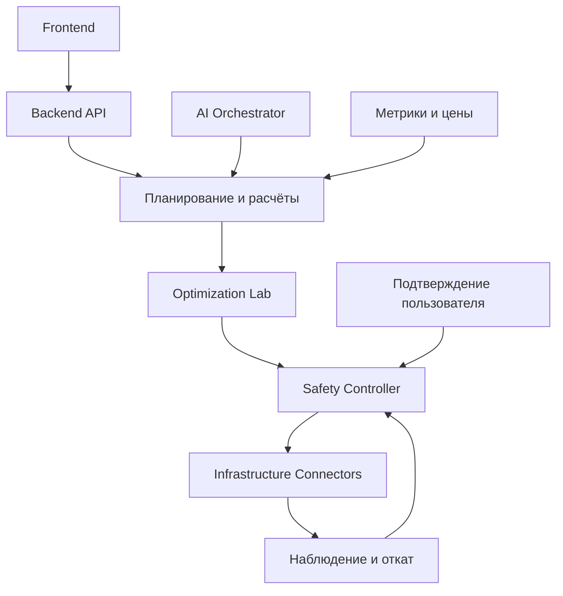

# CloudPilot AI

Планируемая платформа FinOps: анализирует стоимость облачной инфраструктуры,
подбирает конфигурации ресурсов и проверяет их на соответствие требованиям нагрузки и SLO.

**Состояние проекта. Этап 3 добавляет сравнение конфигураций CPU/RAM.** Добавлены реестр источников, read-only Kubernetes
и Prometheus connectors, CSV ресурсов/метрик/биллинга, durable worker PostgreSQL,
история заданий, качество данных и страницы Resources / Sources & imports.
[Запуск, форматы CSV и ограничения](docs/development/collection.md).
[Отчёт и проверки этапа 2](docs/development/stage-2-report.md).
[CI этапа 2 — success](https://github.com/waitran/cloudpilot-ai/actions/runs/44191771451),
включая Compose, большой CSV через Nginx и настоящий Prometheus.
[Репозиторий](https://github.com/waitran/cloudpilot-ai) приватный.
[Рекомендации и сценарии оценки стоимости VM](docs/development/optimization.md).
Проверка SLO под нагрузкой, AI и применение изменений относятся к следующим этапам.

## Проблема

Резерв мощности часто выбирают с запасом, за который приходится платить постоянно.
Уменьшение CPU, RAM или числа машин без проверки нагрузки способно нарушить доступность.
CloudPilot AI должен связывать каждую рекомендацию с исходными данными, ценами,
ограничениями пользователя и результатами экспериментов.

## Планируемые возможности

- Собирать CPU/RAM, Kubernetes-метрики, сведения о стоимости и доступной мощности.
- Формализовать запросы вроде «сэкономить 25% при p95 ≤ 200 мс».
- Генерировать несколько конфигураций, оценивать выполнимость и финансовый результат.
- Проверять кандидатов в изолированной лаборатории через k6 и Prometheus.
- Объяснять компромиссы, недостаток данных и недостижимые требования.
- Готовить планы изменений с подтверждением, canary, мониторингом и откатом.

Это дорожная карта, а не перечень работающих функций. Успешный тест подтверждает
кандидата только в пределах проверенной нагрузки и наблюдаемого периода.

## Предварительная архитектура

Модульный монолит, отдельный worker для длительных задач и изолированная лаборатория.
AI формирует структурированные предложения; расчёты и допуск выполняет проверяемый код.
LLM не получает права записи в облако или Kubernetes.



Границы: [обзор](docs/architecture/overview.md),
[компоненты](docs/architecture/components.md), [безопасность](docs/architecture/security.md).
Схема описывает будущую систему.

## Планируемый стек

| Область | Выбор и момент добавления |
| --- | --- |
| Backend, этап 1 | Python 3.12, FastAPI, Pydantic, SQLAlchemy, Alembic, PostgreSQL |
| Frontend, этап 1 | Node.js 24 LTS, React, TypeScript, Vite, Tailwind CSS; Recharts по потребности |
| Аналитика, этапы 2–4 | Prometheus, OpenCost, Polars, OR-Tools |
| AI, этап 5 | Qwen через Ollama либо совместимый API, LangGraph |
| Лаборатория, этап 6 | Kubernetes, k6, Prometheus |
| Исполнение, этапы 7–8 | HPA, Cluster Autoscaler либо Karpenter, Argo Rollouts |
| Разработка | Git, GitHub Actions; uv, Ruff, pytest, ESLint, Prettier по мере появления кода |

Зависимости этапов 1–2 установлены и закреплены lock-файлами. Стек последующих этапов
добавляется после проверки совместимости и необходимости.

## Локальный запуск

Нужны Docker с доступным daemon, Compose и Python для генерации локального окружения:

```bash
python3.12 scripts/init_env.py
docker compose up --build --wait --wait-timeout 180
```

Открыть [Frontend](http://127.0.0.1:15173), [Backend](http://127.0.0.1:18080),
[Swagger](http://127.0.0.1:18080/docs). PostgreSQL не публикуется на host.
Порты настраиваются в `.env`; они привязаны только к loopback.

Доступны `make up`, `make down`, `make logs`, `make migrate`, `make status`,
`make check`, `make test`, `make smoke`. Генератор создаёт случайный локальный пароль,
не перезаписывает существующий `.env` и не выводит секреты.

Для нативной разработки: Python 3.12 + uv, Node.js 24 + npm 12, доступный PostgreSQL.
Версии зависимостей закреплены lock-файлами. Полные команды, отдельная тестовая БД и
устранение проблем описаны в [setup.md](docs/development/setup.md).

Реализованные API: `/api/v1/health/live`, `/api/v1/health/ready`, `/api/v1/system/info`.
Нет сборщиков облачных метрик, расчётов экономии, LLM или инфраструктурной записи.
[Проверки качества](docs/development/quality.md), [участие в разработке](CONTRIBUTING.md).

## Дорожная карта

| Этап | Результат | Статус |
| --- | --- | --- |
| 0 | Workspace, Git, GitHub, документация, CI | Завершён; private GitHub и CI проверены |
| 1 | Backend, Frontend, PostgreSQL, Docker Compose | Реализован; ограничения запуска в отчёте |
| 2 | Сбор и нормализация метрик | Запланирован |
| 3 | Optimization Engine и расчёт стоимости | Запланирован |
| 4 | Feasibility Engine и Capacity Planner | Запланирован |
| 5 | Qwen Agent и LangGraph | Запланирован |
| 6 | Optimization Lab и проверка SLO | Запланирован |
| 7 | Autoscaling, Capacity Guard, Safety Controller | Запланирован |
| 8 | Approval, canary и rollback | Запланирован |
| 9 | Интеграционная проверка, безопасность, демонстрация | Запланирован |

[Критерии перехода между этапами](docs/development/roadmap.md).
