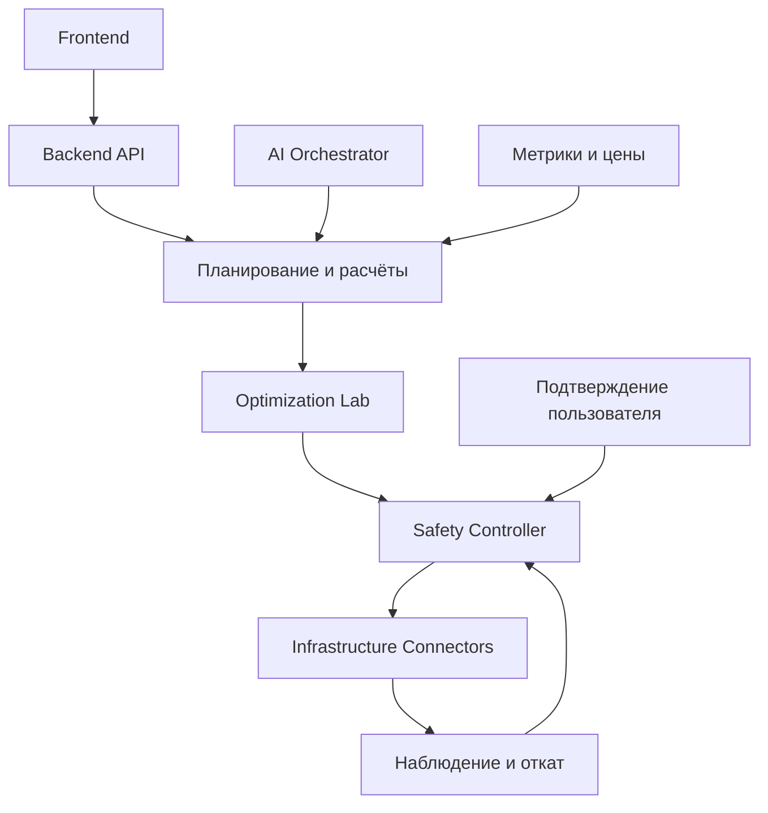

# CloudPilot AI

Планируемая платформа FinOps: анализирует стоимость облачной инфраструктуры,
подбирает конфигурации ресурсов и проверяет их на соответствие требованиям нагрузки и SLO.

**Состояние: локальная подготовка этапа 0. Приложение ещё не реализовано.**
Созданы структура, документация и проверки репозитория. Публикация GitHub и первый запуск CI
остаются открытыми; фактические ограничения описаны в [отчёте](docs/development/stage-0-report.md).
Значка успешного CI пока нет.

## Проблема

Резерв мощности часто выбирают с запасом, за который приходится платить постоянно.
Уменьшение CPU, RAM или числа машин без проверки нагрузки способно нарушить доступность.
CloudPilot AI должен связывать каждую рекомендацию с исходными данными, ценами,
ограничениями пользователя и результатами экспериментов.

## Планируемые возможности

- Собирать CPU/RAM, Kubernetes-метрики, сведения о стоимости и доступной мощности.
- Формализовать запросы вроде «сэкономить 25% при p95 ≤ 200 мс».
- Генерировать несколько конфигураций, оценивать выполнимость и финансовый результат.
- Проверять кандидатов в изолированной лаборатории через k6 и Prometheus.
- Объяснять компромиссы, недостаток данных и недостижимые требования.
- Готовить планы изменений с подтверждением, canary, мониторингом и откатом.

Это дорожная карта, а не перечень работающих функций. Успешный тест подтверждает
кандидата только в пределах проверенной нагрузки и наблюдаемого периода.

## Предварительная архитектура

Модульный монолит, отдельный worker для длительных задач и изолированная лаборатория.
AI формирует структурированные предложения; расчёты и допуск выполняет проверяемый код.
LLM не получает права записи в облако или Kubernetes.



Границы: [обзор](docs/architecture/overview.md),
[компоненты](docs/architecture/components.md), [безопасность](docs/architecture/security.md).
Схема описывает будущую систему.

## Планируемый стек

| Область | Выбор и момент добавления |
| --- | --- |
| Backend, этап 1 | Python 3.12, FastAPI, Pydantic, SQLAlchemy, Alembic, PostgreSQL |
| Frontend, этап 1 | Node.js 24 LTS, React, TypeScript, Vite, Tailwind CSS; Recharts по потребности |
| Аналитика, этапы 2–4 | Prometheus, OpenCost, Polars, OR-Tools |
| AI, этап 5 | Qwen через Ollama либо совместимый API, LangGraph |
| Лаборатория, этап 6 | Kubernetes, k6, Prometheus |
| Исполнение, этапы 7–8 | HPA, Cluster Autoscaler либо Karpenter, Argo Rollouts |
| Разработка | Git, GitHub Actions; uv, Ruff, pytest, ESLint, Prettier по мере появления кода |

Зависимости приложения ещё не устанавливались. Точные версии и lock-файлы появятся
на соответствующих этапах после проверки совместимости.

## Локальная работа сейчас

Нужны Git и Python 3.12. Docker, Node.js и сторонние Python-пакеты для этапа 0 не требуются.
Запускать команды из корня `cloudpilot-ai`:

```bash
python3.12 scripts/check_repository.py
python3.12 -m unittest discover -s tests -v
git diff --check
```

Альтернатива: `make check test`. Скрипт проверяет структуру, конфигурации, ссылки,
Python-синтаксис и признаки секретов в рабочих файлах и в индексе Git.
Проверки исполняются без скачивания пакетов и обращения к облаку.
Backend, UI и Docker Compose пока запустить нельзя: их реализация относится к этапу 1.

Подробнее: [настройка окружения](docs/development/setup.md),
[вклад в проект](CONTRIBUTING.md), [план проверок](docs/development/quality.md).

## Дорожная карта

| Этап | Результат | Статус |
| --- | --- | --- |
| 0 | Workspace, Git, GitHub, документация, CI | Локально готово; GitHub/CI заблокированы окружением |
| 1 | Backend, Frontend, PostgreSQL, Docker Compose | Запланирован |
| 2 | Сбор и нормализация метрик | Запланирован |
| 3 | Optimization Engine и расчёт стоимости | Запланирован |
| 4 | Feasibility Engine и Capacity Planner | Запланирован |
| 5 | Qwen Agent и LangGraph | Запланирован |
| 6 | Optimization Lab и проверка SLO | Запланирован |
| 7 | Autoscaling, Capacity Guard, Safety Controller | Запланирован |
| 8 | Approval, canary и rollback | Запланирован |
| 9 | Интеграционная проверка, безопасность, демонстрация | Запланирован |

[Критерии перехода между этапами](docs/development/roadmap.md).
